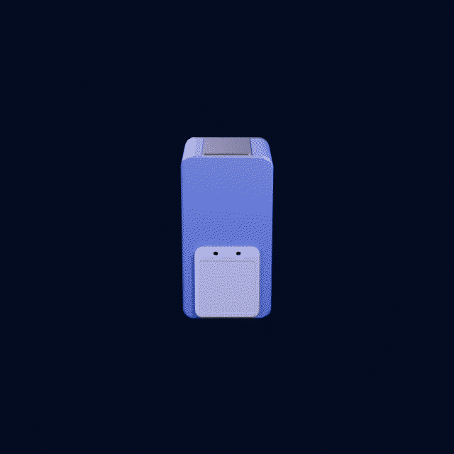
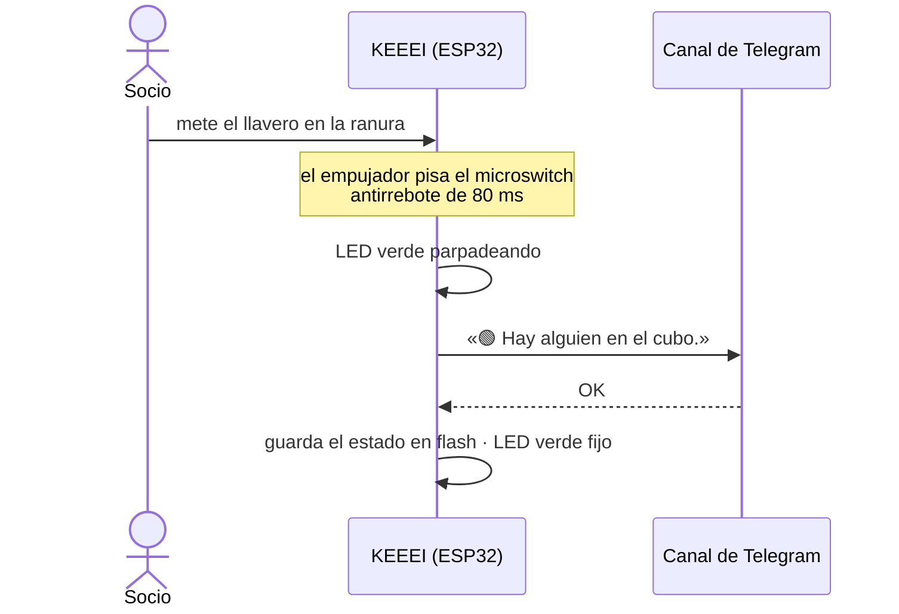
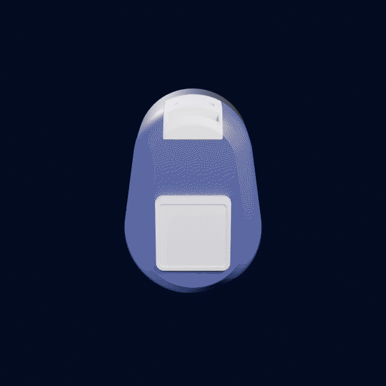
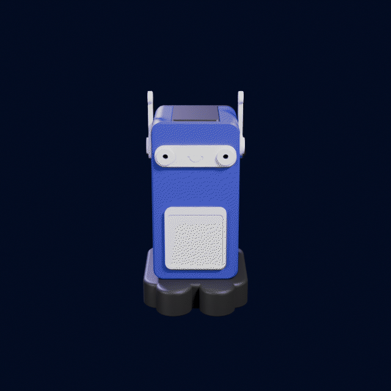

<div align="center">



# KEEEI

**¿Hay alguien en el cubo?** Pregúntaselo a las llaves.

[](https://platformio.org/)
[](docs/telegram.md)
[](#-las-carcasas)

</div>

---

En la IEEE SB Unizar hay una pregunta que se repite más que ninguna otra en el
grupo: *«¿hay alguien en el cubo?»*. Casi siempre llega tarde, casi nunca tiene
respuesta y, de vez en cuando, alguien cruza el campus para encontrarse la
puerta cerrada.

KEEEI acaba con eso. Es un llavero conectado: quien abre el cubo deja las llaves
dentro y quien se va se las lleva. Cada vez que las llaves entran o salen,
el canal de Telegram se actualiza solo.

| Llaves dentro | Llaves fuera |
|:---:|:---:|
| 🟢 **Hay alguien en el cubo.** | 🔴 **No hay nadie en el cubo.** |

El canal muestra siempre **un único mensaje**, el último. KEEEI borra el
anterior antes de publicar, así que no hay que hacer scroll para saber cómo está
el cubo ahora mismo.

## Cómo funciona



Por dentro hay un ESP32, un microswitch de rodillo, un LED verde, otro rojo y
una carcasa impresa en 3D. Si se va la luz o cae el wifi, KEEEI no se inventa
nada: al volver compara el sensor con el último estado guardado en la memoria
flash (NVS) y solo avisa si de verdad ha cambiado algo.

Qué te está diciendo con los LED:

| LED | Significa |
|---|---|
| Verde fijo | Llaves dentro, todo enviado |
| Rojo fijo | Llaves fuera, todo enviado |
| Verde o rojo parpadeando rápido | Enviando el aviso a Telegram |
| Los dos parpadeando rápido | Sin wifi o sin Telegram: lo está reintentando |
| Los dos parpadeando lento | Arrancando, esperando al wifi |

La máquina de estados completa y las decisiones del firmware están en
[docs/firmware.md](docs/firmware.md).

## 🧩 Las carcasas

Hay tres diseños en estudio. Comparten el mismo mecanismo (un **cartucho**
intercambiable con la ranura, el empujador y el microswitch) y la misma
electrónica. Cambia todo lo demás. Cada uno vive en su propia rama de este
repositorio y del documento de Onshape.

<table>
<tr>
<td align="center" width="33%"><br><b>A · Ranura vertical</b><br>De pared, sobria, 5 piezas.<br><a href="https://github.com/rogarciam/KEEEI/tree/carcasa/a-ranura-vertical/modelos-3d/a-ranura-vertical">rama <code>carcasa/a-ranura-vertical</code></a></td>
<td align="center" width="33%"><br><b>B · Canto rodado</b><br>Orgánica, se cuelga de una pletina, 6 piezas.<br><a href="https://github.com/rogarciam/KEEEI/tree/carcasa/b-organica/modelos-3d/b-organica">rama <code>carcasa/b-organica</code></a></td>
<td align="center" width="33%"><br><b>C · Keko</b><br>Un robotito que se traga las llaves, de mesa, 9 piezas.<br><a href="https://github.com/rogarciam/KEEEI/tree/carcasa/c-mascota/modelos-3d/c-mascota">rama <code>carcasa/c-mascota</code></a></td>
</tr>
</table>

Todas siguen las mismas reglas: se imprimen **sin soportes** (voladizos ≤ 45°,
puentes ≤ 10 mm), en piezas que se pegan con pasadores de filamento, y se han
revisado pieza a pieza en su orientación de impresión con un script de
FeatureScript en Onshape. Están pensadas en tres filamentos: blanco, negro y
azul violeta con purpurina.

## Ponerlo en marcha

1. **Monta la electrónica.** Microswitch al GPIO 19, LED verde al 25 y rojo al
   26. El esquema y la lista de materiales están en [docs/hardware.md](docs/hardware.md).
2. **Prepara Telegram.** Crea el bot, añádelo al canal como administrador y
   apunta el `chat_id` ([docs/telegram.md](docs/telegram.md)).
3. **Rellena tus claves.** Copia `include/secrets.h.example` a
   `include/secrets.h` y pon el wifi, el token y el `chat_id`. Ese archivo está
   en `.gitignore`: no se sube nunca.
4. **Compila y flashea** con PlatformIO:
   ```bash
   pio run -t upload
   ```
   Más detalle y problemas típicos en [docs/compilar.md](docs/compilar.md).
5. **Imprime la carcasa** que más te guste, monta y cuelga (o planta) a KEEEI.

## Qué hay en cada sitio

```
src/, include/      firmware (C99 + un poco de C++ para las librerías de Arduino)
docs/               cómo está hecho y por qué
  decisiones/       registro de decisiones (ADR), una por archivo
  calibracion.md    hoja para apuntar medidas y pruebas de impresión
  poster/           plan visual y pósteres
modelos-3d/         en cada rama de carcasa: FeatureScript, STL, render y README
```

## Por qué está hecho así

Cada decisión que no es obvia tiene su ficha corta en
[docs/decisiones](docs/decisiones/README.md): por qué no hay bot, por qué los
mensajes dicen «hay alguien», por qué el mecanismo es un cartucho aparte... Si
vas a cambiar algo gordo, añade la tuya.

## Colaborar

¿Has impreso una carcasa y algo no encaja? Apunta tus medidas en
[docs/calibracion.md](docs/calibracion.md) y abre un *issue*. Para cambios de
código o de diseño, lee [CONTRIBUTING.md](CONTRIBUTING.md).

## Licencia

Pendiente de decidir: la propuesta es MIT para el firmware y CC BY-SA 4.0 para
los modelos, los pósteres y la documentación
([ADR 0004](docs/decisiones/0004-licencias.md)). El nombre y el logo de IEEE
son marcas registradas y no entran en ninguna de las dos.

---

<div align="center">
Hecho en la <b>IEEE Student Branch de la Universidad de Zaragoza</b>.
</div>
