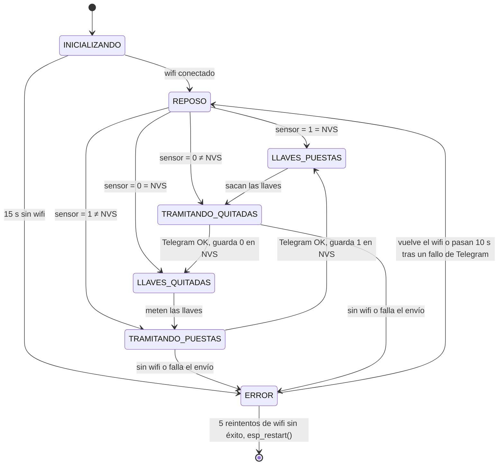

# Firmware

C99 casi todo (`LedManager.c`, `SensorManager.c`), con un poco de C++ allí donde
mandan las librerías de Arduino (`main.cpp`, `TelegramManager.cpp`). Las
cabeceras llevan `extern "C"` para que los dos mundos se entiendan.

| Módulo | Qué hace |
|---|---|
| `SensorManager` | Lee el microswitch por sondeo, con antirrebote de 80 ms, y guarda o lee el último estado en la NVS |
| `LedManager` | Gestiona los LED sin bloquear: fijo, parpadeo rápido (5 Hz) y lento (1 Hz) |
| `TelegramManager` | Wifi y HTTPS. Antes de publicar borra el mensaje anterior, cuyo id también guarda en la NVS |
| `main.cpp` | La máquina de estados en `loop()` y una tarea de FreeRTOS que envía los mensajes |

## La máquina de estados

Detalles que conviene saber antes de tocar nada:

- **El estado bueno es el de la NVS**, no el de la RAM. Solo se escribe cuando
  Telegram confirma el envío. Si falla, al volver a `REPOSO` el sensor no
  coincide con la NVS y el aviso se repite solo. Así no se pierde ningún
  cambio aunque se vaya la luz a mitad.
- **El envío no bloquea el bucle.** `loop()` mete el mensaje en una cola de 5
  huecos y una tarea de FreeRTOS en el núcleo 0 lo envía, con 3 intentos.
  Mientras tanto los LED siguen parpadeando con `millis()`; no hay ningún
  `delay()` en el bucle principal.
- **Los mensajes caben en 64 bytes** (`mensaje_telegram_t.texto`). Ojo: cada
  emoji ocupa 4.
- **Sin ISR.** Antes el sensor iba por interrupción; ahora se lee por sondeo
  con antirrebote de 80 ms, que con un microswitch de rodillo es más
  predecible.

## Pines

| Señal | GPIO | Nota |
|---|---|---|
| Microswitch | 19 | `INPUT_PULLUP`: LOW = llaves dentro |
| LED verde | 25 | HIGH = encendido |
| LED rojo | 26 | HIGH = encendido |
