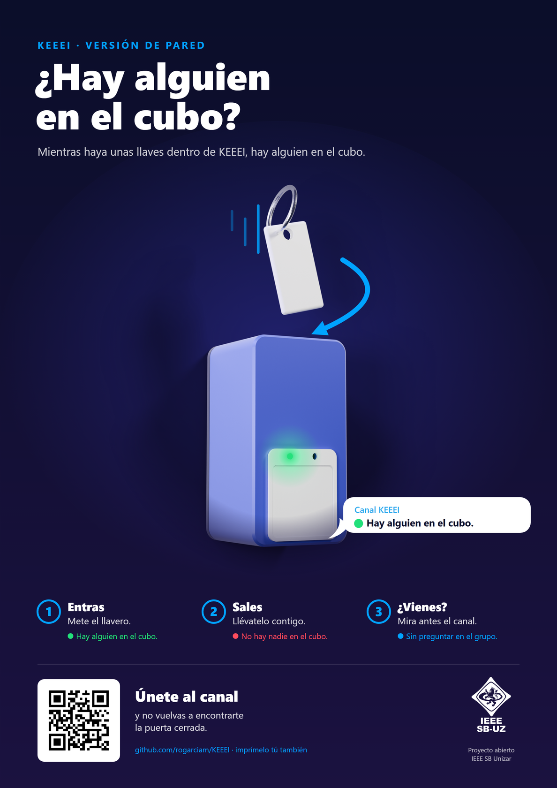
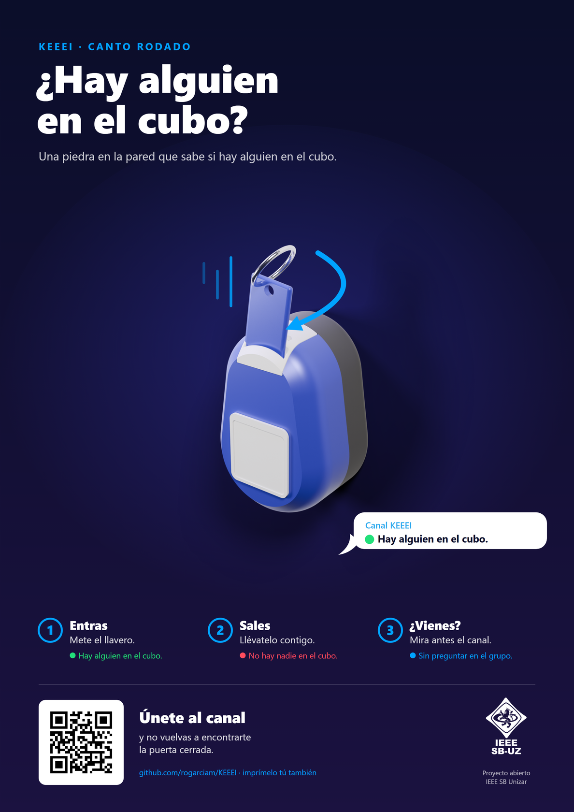
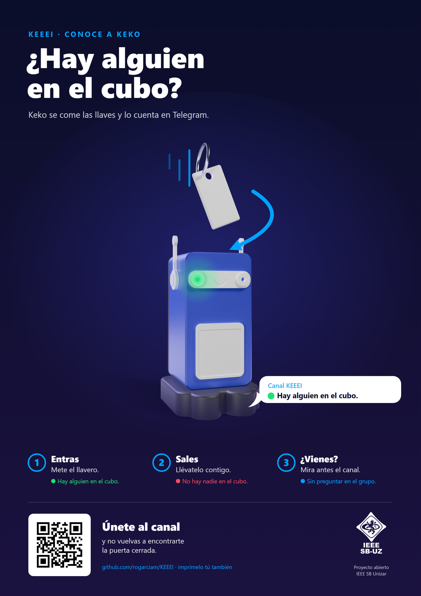

# Pósteres

Uno por carcasa, en A3 vertical, para pegar junto a KEEEI en el cubo. Los tres
cuentan lo mismo (el llavero entra, el LED se pone verde y el canal avisa) y
cada uno enseña su carcasa en su sitio natural: la A y la B colgadas, Keko de
pie en la mesa.

| A · Ranura vertical | B · Canto rodado | C · Keko |
|:---:|:---:|:---:|
| <a href="poster-a.pdf"></a> | <a href="poster-b.pdf"></a> | <a href="poster-c.pdf"></a> |

Para imprimir, usa el **PDF** (A3, sin márgenes). El **SVG** es el original
editable (se abre en Inkscape o Figma) y el **PNG** es solo una vista previa.

## Cómo se hacen

1. **Render** de la carcasa en su postura, con el llavero entrando, en la rama
   de cada carcasa:
   ```bash
   blender -b --python modelos-3d/render/poster_render.py -- <carpeta stl> render-a.png a
   ```
   Sale con fondo transparente y un `.json` con dónde caen en la imagen la
   ranura, el llavero y el LED.
2. Copia `render-<x>.png` y `render-<x>.json` a [`img/`](img) y monta el póster:
   ```bash
   python docs/poster/hacer_poster.py a
   ```
   Escribe el SVG y exporta el PDF y el PNG con Microsoft Edge en modo
   *headless*.

Los colores, las luces y los planos de cámara están razonados en
[plan-visual.md](plan-visual.md).

## Qué hay en `img/`

- `qr-telegram.svg`: QR del canal de Telegram (comprobado: lleva a la
  invitación del canal).
- `logo-ieee-sb-unizar-blanco.png`: el logo de la rama pasado a blanco para el
  fondo oscuro. Es una marca de IEEE: no entra en la licencia del proyecto.
- `render-<x>.png` / `.json`: los renders que usa cada póster.
