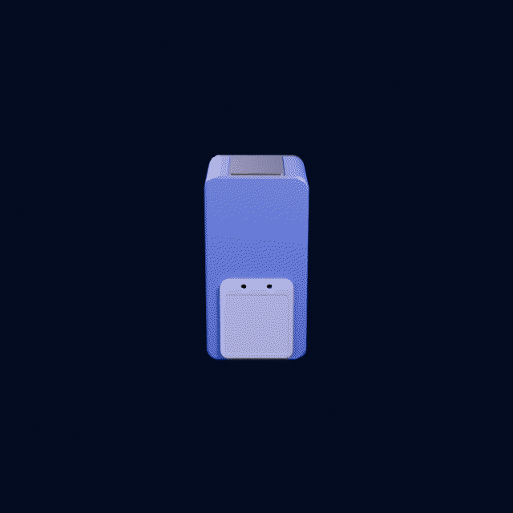

# Carcasa A · Ranura vertical

*La de toda la vida: se cuelga en la pared y no molesta.*

`5 piezas` · `47 × 48 × 90 mm` · `sin soportes` · `pared`

---

Es el diseño de partida y el más sobrio. Una caja de esquinas redondeadas con una
ranura en el techo: dejas caer el llavero, oyes el clic del microswitch y el LED
verde se pone a parpadear hasta que Telegram confirma el aviso.

Lo interesante está dentro. El mecanismo va en un **cartucho** que se imprime
aparte, tumbado, para que la ranura salga lisa y no haya que tender un puente de
22 mm sobre ella. Si el llavero no hace clic, reimprimes el cartucho (unos
10 g) y no la caja entera. B y C usan este mismo cartucho.

## Las piezas

| | Pieza | Color | Cómo se imprime |
|:-:|---|---|---|
| 1 | Cuerpo | azul violeta | cara frontal sobre la cama |
| 2 | Cartucho del mecanismo | negro | tumbado de lado |
| 3 | Frontal con el QR y los LED | blanco | cara trasera sobre la cama |
| 4 | Tapa trasera | negro | cara de la pared sobre la cama |
| 5 | Empujador | blanco | de pie |

Ninguna necesita soportes. Lo comprobamos con un script que mira, cara por
cara, que ninguna baje de 45° y que ningún puente pase de 10 mm. El único aviso
que queda es el agujero del USB (13,5 mm), que no se puede estrechar porque si
no la clavija no pasa.

## Montarla

1. Mete los 4 insertos M3 en el cuerpo con el soldador.
2. Pon el empujador en su guía y atornilla el microswitch al cartucho.
3. Desliza el cartucho por detrás hasta que apoye en su nervio y pégalo.
4. Centra el frontal con dos trocitos de filamento de 1,75 mm y pégalo. Los
   LED se meten desde dentro.
5. Coloca la protoboard en la tapa, cierra con 4 tornillos M3 y cuélgala por
   los dos ojales.

## Archivos

- [`carcasa_llaves_esp32.fs`](carcasa_llaves_esp32.fs): el modelo paramétrico
  (FeatureScript de Onshape). Todas las holguras son parámetros.
- [`stl/`](stl): las 5 piezas listas para laminar, en posición de montaje
  (gíralas en el laminador).
- [`detalles-tecnicos.md`](detalles-tecnicos.md): cotas, auditoría completa y
  el porqué de cada cambio.

> Las holguras siguen siendo las supuestas. Si la imprimes, apunta cómo te ha
> salido en [docs/calibracion.md](../../docs/calibracion.md): nos sirve para las
> tres carcasas.

Otras opciones: <a href="https://github.com/rogarciam/KEEEI/tree/carcasa/b-organica/modelos-3d/b-organica">B · canto rodado</a> · <a href="https://github.com/rogarciam/KEEEI/tree/carcasa/c-mascota/modelos-3d/c-mascota">C · Keko</a>

