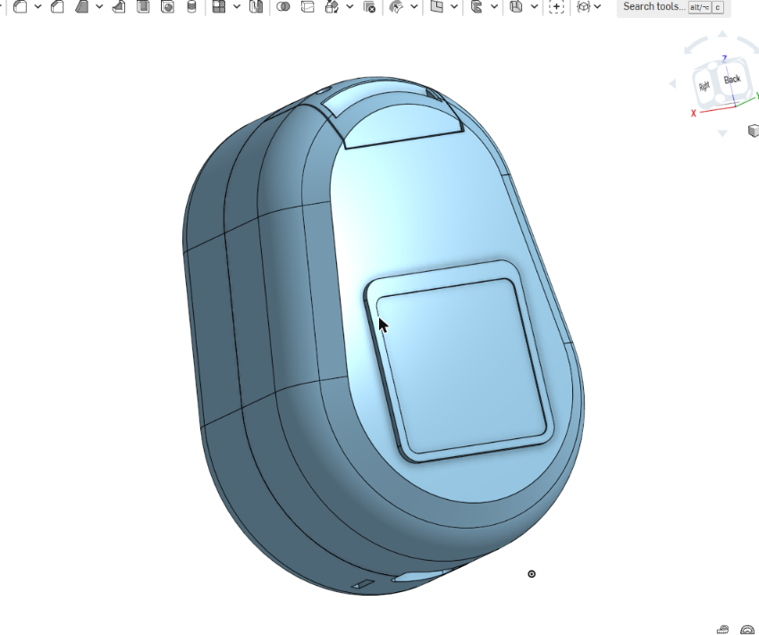

# Carcasa B · Canto rodado

*Como si alguien hubiera colgado una piedra de río en la pared.*

`6 piezas` · `64 × 49 × 93 mm` · `sin soportes` · `pared, con pletina`

---

La pedimos con una condición: que no fuera una caja. El resultado es un óvalo
algo más ancho por abajo, como un huevo o una semilla, sin una sola arista viva a
la vista. Por arriba asoma una franja de otro color: es el cartucho del
mecanismo, el mismo de la carcasa A, que aquí hace de costura.

Los LED van arriba, junto a la boca de la ranura. Así, al dejar las llaves, el
verde te lo dice justo donde estás mirando.

## El truco para imprimirla sin soportes

Una forma orgánica casi siempre necesita soportes. Esta no: está partida por un
plano a la altura del USB, de modo que cada mitad apoya plana en la cama. Además,
todos los bordes empiezan con un chaflán de 45° que se convierte en un redondeo
grande, así el perfil nunca pasa de 45°. El agujero del USB queda repartido entre
las dos mitades y deja de ser un puente.

| | Pieza | Color | Cómo se imprime |
|:-:|---|---|---|
| 1 | Concha frontal | azul violeta | cara delantera sobre la cama |
| 2 | Concha trasera | negro | cara de la pared sobre la cama |
| 3 | Cartucho del mecanismo | blanco | tumbado de lado (igual que en la A) |
| 4 | Frontal con el QR | blanco | cara trasera sobre la cama |
| 5 | Empujador | blanco | de pie |
| 6 | Pletina de pared | negro | plana |

## Colgarla

La pletina se atornilla a la pared con dos tornillos y la carcasa baja
deslizando 2 mm hasta engancharse, como un cuadro con *French cleat*. Para
descolgarla, la subes y la sacas.

## Archivos

- [`carcasa_b.fs`](carcasa_b.fs): modelo paramétrico de Onshape (feature
  `carcasaKeeeiB`). Mismas holguras y parámetros que la A.
- [`detalles-tecnicos.md`](detalles-tecnicos.md): geometría, medidas por pieza,
  auditoría y tornillería.

> Pendiente de decidir: es más grande que la A (64 mm de ancho, porque la
> protoboard tiene que caber en el óvalo) y la pletina engancha solo 1,4 mm.
> Hablamos de ello en la [ADR 0007](../../docs/decisiones/0007-carcasa-b-organica.md).

Otras opciones: <a href="https://github.com/rogarciam/KEEEI/tree/carcasa/a-ranura-vertical/modelos-3d/a-ranura-vertical">A · ranura vertical</a> · <a href="https://github.com/rogarciam/KEEEI/tree/carcasa/c-mascota/modelos-3d/c-mascota">C · Keko</a>

