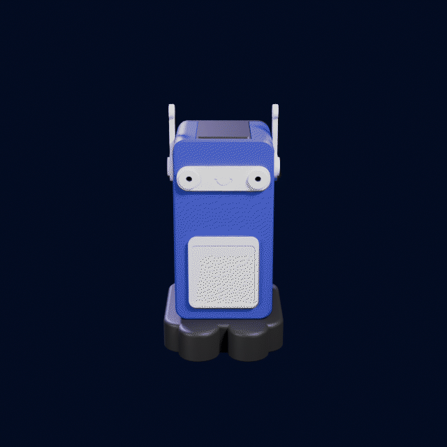

# Carcasa C · Keko

*Se come las llaves y te guiña un ojo.*

`9 piezas` · `118 mm de alto` · `sin soportes` · `de mesa`

---

Keko es un robotito hucha. Le echas las llaves por la ranura de la cabeza y se le
encienden los ojos: verde si alguien acaba de llegar, rojo cuando se va el
último. El QR del canal lo lleva en la barriga y las dos antenas están ahí
porque, al fin y al cabo, es un aparato con wifi.

Es un personaje inventado para KEEEI, sin parecido con ninguna mascota ajena:
el repositorio y los pósteres son públicos y queremos poder imprimirlo y
enseñarlo sin problemas.

A diferencia de A y B, Keko no se cuelga: va de pie sobre la mesa. La peana
lleva hueco para 4 tuercas M8 de lastre. Con 40 g de llaves dentro, el centro de
masas sigue a 23 mm del borde, así que no se cae ni cuando le dejas las llaves de
golpe.

## Las piezas

| | Pieza | Color | Cómo se imprime |
|:-:|---|---|---|
| 1 | Cuerpo | azul violeta | cara frontal sobre la cama |
| 2 | Cartucho del mecanismo | negro | tumbado de lado (igual que en la A) |
| 3 | Tapa trasera | negro | cara exterior sobre la cama |
| 4 | Cara (ojos y sonrisa) | blanco | cara trasera sobre la cama |
| 5 | Barriga con el QR | blanco | cara trasera sobre la cama |
| 6–7 | Orejas-antena | blanco | planas |
| 8 | Peana | negro | cara inferior sobre la cama |
| 9 | Empujador | blanco | de pie |

Las piezas de colores se pegan con pasadores de filamento de 1,75 mm, así que se
puede sacar en tres colores con una impresora de un solo extrusor.

## Archivos

- [`carcasa_c.fs`](carcasa_c.fs): modelo paramétrico de Onshape (feature
  `carcasaKeeeiC`). La cara, la peana y las orejas tienen sus propios
  parámetros.
- [`stl/`](stl): las 9 piezas listas para laminar, en posición de montaje
  (gíralas en el laminador).
- [`detalles-tecnicos.md`](detalles-tecnicos.md): croquis, parámetros nuevos,
  montaje y auditoría (vuelco incluido).

> Pendiente de decidir: el cuerpo de Keko sigue siendo bastante cuadrado, y
> está en estudio una versión más redondeada con el mismo interior. Lo
> hablamos en la [ADR 0008](../../docs/decisiones/0008-carcasa-c-mascota.md).

Otras opciones: <a href="https://github.com/rogarciam/KEEEI/tree/carcasa/a-ranura-vertical/modelos-3d/a-ranura-vertical">A · ranura vertical</a> · <a href="https://github.com/rogarciam/KEEEI/tree/carcasa/b-organica/modelos-3d/b-organica">B · canto rodado</a>

